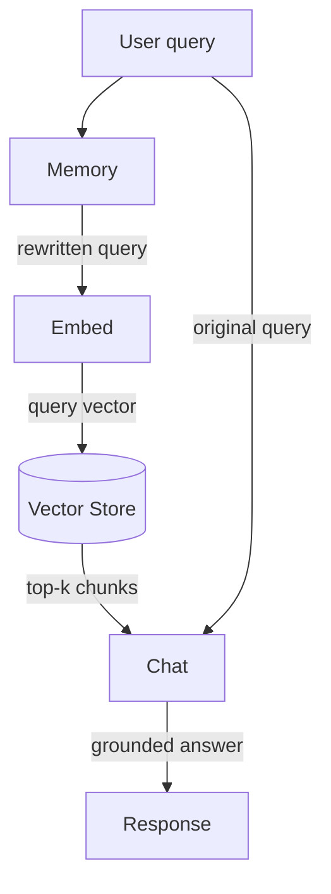

# Ragrig — RAG framework for Research and Prototyping


A **trait-driven Retrieval-Augmented Generation library** built around three
independently swappable AI agents — **Embed**, **Memory**, and **Chat** —
each behind a Rust trait that allows hot-swapping backends at runtime.

**Designed for students and researchers.**  The default build compiles with
zero external dependencies — no C++ toolchain, no `cmake`, no `protoc`.
Install Rust, install Ollama, and you're done.

> **🔧 ragrig is the library crate.**  The terminal REPL binary lives in
> [**ragrig‑cli**](https://github.com/schmettow/ragrig-cli) — install with
> `cargo install ragrig-cli` or clone from GitHub.
> Build your own application on top of the same traits the REPL uses.

- **Zero extra dependencies** — default build is pure Rust; Ollama provides
  models at runtime
- **Trait-driven** — every pipeline stage is a `Box<dyn Trait>`; add new
  backends (OpenAI, Anthropic, Groq, …) or document parsers without touching
  existing code
- **Hardware-aware** — delegate heavy models to the cloud, run small models
  locally, or go fully offline with CPU-only Fastembed (compiled into the binary)
- **Hot-swappable** — switch chat, memory, or embedding engines at runtime
  without losing document index or conversation context
- **Token-efficient cloud usage** — use a tiny local model for query rewriting
  and only send the final prompt + context to an expensive cloud API
- **Hybrid retrieval** — BM25 full-text search fused with cosine vector
  similarity via Reciprocal Rank Fusion.  Hot-swappable ranking algorithms
  (RRF, weighted linear, MMR diversity, LLM re-rank) let you experiment
  with retrieval strategies without changing your document index
- **Multi-corpus** — several document collections (folders, curated URL
  lists, …) share one vector store, each keeping its own provenance name;
  search everything, or scope a query to a single corpus
- **Pluggable ranking** — the `Ranker` trait decouples scoring from storage;
  compare Cosine vs. BM25 vs. RRF fusion on the same document set at runtime
- **Cross-platform** — Linux, macOS, WSL, and Windows (MSVC / MinGW)

---

## What is RAG?

**Retrieval-Augmented Generation** lets an LLM answer questions about documents
it has never seen before.  Instead of stuffing every document into the prompt
(which would overflow the context window), RAG works in two phases:

1. **Indexing** — Documents are split into overlapping *chunks*, each chunk is
   converted to a numeric *embedding vector* (a list of floats that captures
   its meaning), and both the text and its vector are saved in a *vector store*.

2. **Querying** — When you ask a question, the same embedding model converts
   your query to a vector.  The store finds the *k* most similar chunks (via
   cosine similarity, BM25 keyword matching, or a hybrid of both).  Those chunks
   are injected into the LLM prompt alongside your question, so the model can
   ground its answer in your documents.

Ragrig wraps this pipeline in three swappable agents — **Embed** (vectorise),
**Memory** (optionally rewrite the query for better retrieval), and **Chat**
(generate the final answer).  The diagram below shows how data flows through
the system:



If you are new to these concepts, a more detailed introduction can be found at
[retrieval-augmented-generation](https://www.promptingguide.ai/techniques/rag)
on the Prompt Engineering Guide.

## Quick Start (Library)

Add ragrig to your `Cargo.toml`:

```toml
[dependencies]
ragrig = "1"
```

### You need two things

1. **Rust** — [rustup.rs](https://rustup.rs) (1.88 or newer; the `vision-pdf` feature needs 1.92)
2. **Ollama** — [ollama.com/download](https://ollama.com/download) (provides models at runtime)

Pull the models you need:

```bash
ollama pull qwen3.5:9b             # chat
ollama pull nomic-embed-text        # embeddings
```

### Index and query in 4 function calls

```rust
use ragrig::{
    embed::EmbedderSpec,
    agents::ChatAgentSpec,
    parsers::{DocumentParsers, build_parsers},
    store::open_store,
    types::ChunkConfig,
    FolderCorpus, GenerationParams, MarkdownChunker,
    vector::{ingest_corpus, search_similar},
};
use std::path::Path;

let embedder = EmbedderSpec::ollama("nomic-embed-text").build()?;
let chat = ChatAgentSpec::ollama("qwen3.5:9b", GenerationParams::default(), None).build()?;
let parsers = DocumentParsers::new(build_parsers());
let store = open_store(Path::new("./my_docs")).await?;

// Index — any Chunker works here (MarkdownChunker, ChunkedrsChunker, …)
let corpus = FolderCorpus::named("folder", Path::new("./my_docs"));
ingest_corpus(&corpus, &parsers, &MarkdownChunker, &*embedder, &ChunkConfig::default(), &*store).await?;

// Search
let results = search_similar(&*embedder, 5, 0.0, &*store, "quantum computing").await?;

// Generate
chat.generate("Summarise the following:\n\n...").await?;
```

### Pure chat — no documents

`RagAgent` covers the whole spectrum.  With an empty store (the builder
default) or `EmbedderSpec::None`, retrieval finds nothing and the agent
degenerates into a pure chat wrapper answering from the no-docs prompt
(`chat_without_docs_prompt`) — the same type serves from “ask the bare LLM”
to “multi-corpus RAG with query rewriting”:

```rust
use ragrig::{agents::ChatAgentSpec, embed::EmbedderSpec, GenerationParams, RagAgent};

let agent = RagAgent::builder()
    .chat(ChatAgentSpec::ollama("qwen3.5:9b", GenerationParams::default(), None).build()?)
    .embed(EmbedderSpec::None.build()?)
    .build()?;

let reply = agent
    .generate_with_context("What is the capital of France?", &[] as &[(&str, &str)])
    .await?;
println!("{reply}");
```

### Model parameters

Control generation with `GenerationParams`:

```rust
use ragrig::{agents::ChatAgentSpec, GenerationParams};

let agent = ChatAgentSpec::ollama(
    "qwen3.5:9b",
    GenerationParams {
        temperature: Some(0.1),  // near-deterministic
        seed: Some(42),          // reproducible runs
        ..Default::default()
    },
    None,
).build()?;
```

See [`examples/pseudonymizer`](examples/pseudonymizer/src/main.rs) for a
complete multi-turn pseudonymization loop.

### Example projects — starting points

The repo ships two tiers of examples:

- **Plain examples** — `examples/*.rs` (single files, **published with the
  crate**): `minimal`, `multi_corpus`, `chunk_compare`, `meta_citation`.
  Run them with `cargo run --example <name>`.
- **Elaborate example crates** — `examples/<name>/` (standalone projects,
  **not published**; clone the repo and run via `--manifest-path`).  These
  are the best starting points for building on ragrig:

| Example | What it shows |
|---|---|
| `examples/rag_query` | Single-shot pipeline: index → search → generate |
| `examples/dialog` | Two `RagAgent`s sharing one vector store and one transcript |
| `examples/streaming_chat_egui` | GUI chat with markdown bubbles, token progress bar, cancel button |
| `examples/streaming_chat_ratatui` | TUI chat with a token gauge and Esc-cancel |
| `examples/streaming_chat_iced` | GUI with provider/model picker, indexing progress bar, cancel buttons |
| `examples/embedded_togo` | Vector store indexed at build time, baked into the binary |
| `examples/candle_hello` | Minimal in-process LLM smoke test (`CandleGenerator`) with token/timing stats |
| `examples/pseudonymizer` | Multi-turn pseudonymization loop |
| `examples/eliza_generator` | A minimal custom `Generator` backend (ELIZA) |
| `examples/pdf_bench` · `examples/prompt_bench` | Parser and prompt/chunking benchmarks |

For example:

```sh
git clone https://github.com/schmettow/ragrig.git
cd ragrig
cargo run --manifest-path examples/streaming_chat_egui/Cargo.toml
```

## Three-Agent Architecture

Every pipeline stage is a **trait object** — swap any agent at runtime
without losing your document index or conversation memory.

### Stability tiers

The 1.0.0 freeze formalises two stability tiers:

- **Tier 1 — stable**: the core traits (`Generator`, `Embedder`,
  `VectorStore`, `DocumentParser`, `Chunker`, `Corpus`, `Ranker`),
  `RagAgent`, the error types, and the `vector` / `store` / `corpora` /
  `parsers` / `chunker` / `embed` / `agents` / `longterm_memory`
  surfaces.  Additive-only changes from 1.0.0 on.
- **Tier 2 — experimental**: `AgentSession` (the `session` module), the
  `progress` module (`Progress`, `Cancel`, `CancellationToken`,
  `ProgressEvent`), and the document-metadata feature — the `citation`
  module (`CitationFormatter`) plus the semantics of `Document.meta` /
  `ChunkMeta.document_meta` (the field types are stable; key conventions
  and consumption are not).  Convenience layers and new seams over the
  core — they may change in 1.x minor releases without a semver break
  for Tier 1 users, and are promoted to Tier 1 only after a soak release
  with no changes.

Build on Tier 1 when you need the stability guarantee; the Tier 2
shells are sugar you can adopt early, knowing they may still evolve.

```
Documents (PDF/EPUB/DOCX/HTML)
    │
    ▼
Chunker trait — strategy pluggable, hot-swappable
    MarkdownChunker    (heading → paragraph → token, default)
    TokenChunker       (plain token windows)
    ChunkedrsChunker   (recursive / markdown / code / html, token-accurate)
    TextSplitterChunker (Unicode-boundary + CommonMark, feature-gated)
    CognigraphChunker   (delimiter-boundary core, feature-gated)
    │
    ├── Embedder trait ──────────────────────────────────────────┐
    │   OllamaEmbedder       (local, nomic-embed-text)           │
    │   FastembedEmbedder    (CPU-only, Nomic-Embed-Text-v1.5)   │
    │   NoopEmbedder         (pure chat, no document search)     │
    │                                                             │
    ▼                                                             │
VectorStore trait ────────────────────────────────────────────────┤
    BruteForceStore   (pure Rust, MessagePack on disk)  ← default │
    LanceDbStore      (Arrow columnar, hybrid BM25+vector)        │
    │                                                             │
    ▼                                                             │
Query                                                                    
    │                                                                    
    ▼                                                                    
Memory / query rewriting (Generator trait) ← hot-swap: /memory
    any Generator (Ollama, DeepSeek, custom)                             
    │                                                                    
    ▼                                                                    
Embed → VectorStore.search → Ranker → top-k chunks                   
    │                                                                    
    ▼                                                                    
Attach strategy (AttachStrategy trait) ← builder: .attach_strategy()   
    PrependAttach / AppendAttach / ReplaceAttach / NoopAttach           
    │                                                                       
    ▼                                                                       
Chat agent (Generator trait)           ← hot-swap: /chat                
    OllamaGenerator / DeepSeekGenerator                                   
    │                                                                    
    ▼                                                                    
Streamed response with retrieved context + conversation memory           
```

**Pipeline provenance.** Every stored chunk records which
(parser, chunker, embedder) pipeline built it.  Index several pipelines
into one store and switch between them at query time:

```rust
use ragrig::{ChunkedrsChunker, Chunker, MarkdownChunker, PipelineFilter, RagAgent};

// Index the same folder once per chunking strategy — the store keeps
// both pipelines side by side (deduplicated by corpus + parser + chunker).
let mut agent = /* … build your RagAgent … */;
for chunker in [
    Box::new(MarkdownChunker) as Box<dyn Chunker>,
    Box::new(ChunkedrsChunker::markdown()),
] {
    agent.set_chunker(chunker);
    agent.reindex_folder("./my_docs").await?;
}

// At query time, select one pipeline — the benchmarking primitive.
agent.set_search_filter(Some(PipelineFilter::for_chunker("chunkedrs-markdown")));
let answer = agent
    .generate_with_context("What is RAG?", &[] as &[(&str, &str)])
    .await?;
```


## Compilation Paths

### Default — Zero extra dependencies (recommended)

```bash
cargo build --release
```

Nothing to install beyond Rust itself.  Uses a pure-Rust
vector store (custom BM25 + cosine similarity + RRF fusion, persisted to
MessagePack).  Embeddings come from Ollama over HTTP at runtime.

This is the path we ship to students.  It compiles without a C++ toolchain,
`cmake`, or `protoc` — works on Windows, macOS, and Linux with zero platform
friction.

### Internal embeddings — Fastembed (CPU-only)

```bash
cargo build --release --features internal-embed
```

Adds `FastembedEmbedder` — runs Nomic-Embed-Text-v1.5 on
the CPU.  Zero network overhead for embeddings.  Needs a C compiler (`gcc`
or `cl.exe`) at build time.  Use `/embed fastembed` at runtime.

### LanceDB backend (large collections)

```bash
cargo build --release --no-default-features --features lancedb,ollama-embed
```

LanceDB 0.37 is pure Rust (Arrow, DataFusion, and the lance-* crates all
come from crates.io) — no Arrow C++ and no `cmake` anymore.  The only
build-time tools beyond the default C compiler are `protoc` (the protobuf
compiler, used by lance's build script) and a C compiler for the
compression codecs.  Faster hybrid search for collections with 100k+
chunks.

### Feature flags

| Flag | Default | Description |
|---|---|---|
| `ollama-embed` | **on** | Local embeddings via Ollama HTTP (no extra deps) |
| `internal` | **on** | Pure-Rust vector store (MessagePack + cosine + BM25) |
| `internal-embed` | off | In-process Fastembed embeddings (needs C compiler) |
| `internal-generate` | off | In-process Candle LLM — zero network inference |
| `offline` | off | Meta: enables `internal` + `internal-embed` + `internal-generate` |
| `lancedb` | off | LanceDB hybrid index (needs `protoc` at build time) |
| `test-fixtures` | off | Compile-time embedded test documents for downstream crates |
| `kreuzberg` | off | Kreuzberg PDF parser (OCR, layout, DOCX) |
| `vision-pdf` | off | Vision-VLM PDF parser — hayro page rasterisation + an Ollama vision model (needs Rust 1.92) |
| `chunker-textsplitter` | off | `TextSplitterChunker` — text-splitter Unicode-boundary + CommonMark splitters |
| `chunker-cognigraph` | off | `CognigraphChunker` — cognigraph-chunker delimiter-boundary core (pulls ONNX Runtime) |

The `offline` feature is a convenience meta-flag that enables every local
component: chat, embeddings, and vector store all run in-process with zero
network dependencies.  Use `offline-cuda`, `offline-metal`, or `offline-mkl`
for GPU-accelerated variants.

### `chunkedrs` — known limitation at tiny chunk sizes

ragrig depends on the released `chunkedrs` 2.1.1.  One upstream
limitation is worth knowing: at **very small chunk sizes** (≈24 tokens)
the overlap carry-over can be lost at some chunk boundaries, so adjacent
chunks may not share the requested `chunk_overlap`.  At sizes of 48
 tokens and up — the configurations ragrig defaults to (`chunk_size =
1024`) — the overlap behaves as documented.  A regression test provokes
 the problem and is ignored by default:
`chunkedrs_upstream_drops_overlap_at_small_chunk_sizes` in
`src/chunker.rs`; it will be re-enabled when an upstream fix lands.

---

## Requirements

| Dependency | When needed |
|---|---|
| Rust 1.94+ | Build (always) |
| Ollama | Runtime — provides chat, embed, and memory models |
| C compiler (`gcc`/`cl.exe`) | Build (always — TLS/compression crates compile C; `internal-embed` and `lancedb` add more) |
| `protoc` (protobuf compiler) | Only with `lancedb` feature |

**Default build: Rust + Ollama.  Nothing else.**

---

## Platform Setup

### Linux / macOS / WSL

```bash
curl --proto '=https' --tlsv1.2 -sSf https://sh.rustup.rs | sh   # Rust
cargo build --release                                                # that's it
```

### Windows

1. Install Rust from [rustup.rs](https://rustup.rs) (MSVC host triple, the default)
2. Run `cargo build --release`

No extra tools needed.  If you later want Fastembed (`--features internal-embed`),
install the [Visual C++ Build Tools](https://visualstudio.microsoft.com/visual-cpp-build-tools/)
(select "C++ build tools" workload).

---

> For the REPL commands, CLI flags, and interactive usage, see the
> [`ragrig-bin` README](https://github.com/schmettow/ragrig-bin).

---

## API Usage (Developers)

ragrig is a library.  Build your own frontend — GUI, web server, headless
bot — on top of the same traits.

```rust
use ragrig::{
    embed::{EmbedderSpec, OllamaEmbedder},
    agents::{ChatAgentSpec, Generator},
    parsers::{DocumentParsers, build_parsers},
    store::open_store,
    types::ChunkConfig,
    FolderCorpus, MarkdownChunker,
    vector::{ingest_corpus, search_similar},
};
use std::path::Path;

// Build agents and parser registry
let embedder = EmbedderSpec::Ollama { model: "nomic-embed-text".into() }.build()?;
let chat_agent = ChatAgentSpec::Ollama { model: "qwen3.5:9b".into(), params: Default::default() }
    .build()?;
let parsers = DocumentParsers::new(build_parsers());
let folder = Path::new("./my_docs");
let chunk_cfg = ChunkConfig::default();
let store = open_store(folder).await?;

// Index documents
let corpus = FolderCorpus::named("folder", folder);
let _stats = ingest_corpus(&corpus, &parsers, &MarkdownChunker, &*embedder, &chunk_cfg, &*store).await?;

// Search
let results = search_similar(&*embedder, 5, 0.0, &*store, "quantum computing").await?;

// Chat
chat_agent.generate_stream(&prompt, &|token| { print!("{}", token); }).await?;
```

### Configuration profiles

`RagrigConfig` is the library's single format-agnostic configuration surface.
It composes four sub-configs (`ChatConfig`, `EmbedConfig`, `ParseConfig`,
`MemoryConfig`) and derives `Serialize` + `Deserialize` — so the same struct
works for CLI arguments, JSON, TOML, or programmatic construction.

**Three entry points:**

```rust
use ragrig::types::RagrigConfig;

// 1. Programmatic — builder-style via Default + struct update
let config = RagrigConfig {
    folder: "./my_docs".into(),
    chat: ChatConfig { model: "gemma4:e4b".into(), ..Default::default() },
    ..Default::default()
};

// 2. From a JSON file (zero extra dependencies — serde_json is already included)
let json = std::fs::read_to_string("profile.json")?;
let config: RagrigConfig = serde_json::from_str(&json)?;

// 3. From a TOML file (add `toml = "0.8"` to Cargo.toml)
let toml_str = std::fs::read_to_string("profile.toml")?;
let config: RagrigConfig = toml::from_str(&toml_str)?;
```

**Example TOML profile** — save this as `profile.toml` and load it at startup
via a small wrapper binary, or deserialise it programmatically:

```toml
folder = "./research-papers"
semantic_scholar_api_key = "s2k-xxxxxxxxxxxx"

[chat]
provider = "Ollama"
model = "qwen3.5:9b"
context_tokens = 4096
context_size_mode = "Auto"

[chat.params]
temperature = 0.1
max_tokens = 2048

[embed]
provider = "Ollama"
model = "nomic-embed-text"
top_k = 20
similarity_threshold = 0.04

[parse]
pdf_parser = "Extract"
chunk_size = 512
chunk_overlap = 64

[memory]
model = "qwen2.5:1.5b"
# rewrite (default) | transcript | log | summary | off
strategy = "rewrite"
```

**Merging CLI overrides on top of a profile** — use `override_with()` to
apply only the fields the user explicitly changed on the command line:

```rust
// Load the base profile
let mut config: RagrigConfig = serde_json::from_str(&fs::read_to_string("profile.json")?)?;

// Parse CLI args and convert to a RagrigConfig (binary-side code)
let cli_config = RagrigConfig::from(Cli::parse());

// Merge: CLI values override profile values where they differ from defaults
config.override_with(&cli_config);
```

### Adding a new backend

Implement the `Generator`, `Embedder`, `VectorStore`, or `DocumentParser` trait:

```rust
struct OpenAiChat { model: String, api_key: String }

#[async_trait]
impl Generator for OpenAiChat {
    async fn generate_stream(&self, prompt: &str, on_token: &(dyn Fn(String) + Sync)) -> Result<()> {
        // POST to https://api.openai.com/v1/chat/completions, stream SSE chunks
    }
    fn backend_name(&self) -> &'static str { "OpenAI" }
    fn model_name(&self) -> &str { &self.model }
}
```

Then wire it into `ChatAgentSpec::parse("openai", ...)` — no other code changes needed.

### Implementing a new document parser

Add support for a new PDF backend or file format (~30 lines).  Example using
`justpdf` (pure-Rust PDF library):

```rust
use ragrig::parsers::DocumentParser;
use std::path::Path;

struct JustpdfParser;

impl DocumentParser for JustpdfParser {
    fn extensions(&self) -> &[&str] { &["pdf"] }

    fn parse(&self, path: &Path) -> anyhow::Result<String> {
        let bytes = std::fs::read(path)?;
        let doc = justpdf::Document::load(&bytes)?;
        let mut md = String::new();
        for page in doc.pages() {
            md.push_str(&page.text());
            md.push_str("\n\n");
        }
        Ok(md)
    }

    fn name(&self) -> &'static str { "justpdf" }
}
```

Then register it in `parsers::build_parsers()` (or hot-swap via `/parser pdf justpdf`
once you add the variant to `PdfParserBackend`).  The chunker, embedder, and search
pipeline all work unchanged — they only see Markdown.

### Implementing a custom chunker

Chunking strategies implement the [`Chunker`] trait — the same `Box<dyn Trait>`
pattern as every other pipeline stage.  A custom algorithm is ~15 lines:

```rust
use async_trait::async_trait;
use ragrig::{ChunkedText, Chunker, ChunkConfig};

/// Sentence-window chunker: group sentences into chunks up to `size` tokens
/// (1 token ≈ 4 chars), overlapping by one sentence.
#[derive(Debug, Clone, Default)]
struct SentenceChunker;

#[async_trait]
impl Chunker for SentenceChunker {
    /// Stable id — recorded in every chunk's provenance and used for filtering.
    fn name(&self) -> &'static str { "sentence" }

    async fn chunk(&self, text: &str, config: &ChunkConfig) -> anyhow::Result<Vec<ChunkedText>> {
        let sentences: Vec<&str> = text.split(['.', '!', '?']).map(str::trim).filter(|s| !s.is_empty()).collect();
        let max_chars = config.size * 4; // token → char heuristic
        let mut chunks = Vec::new();
        let mut current = String::new();
        for sentence in sentences {
            if !current.is_empty() && current.len() + sentence.len() > max_chars {
                chunks.push(ChunkedText::plain(std::mem::take(&mut current)));
            }
            current.push_str(sentence);
            current.push_str(". ");
        }
        if !current.is_empty() { chunks.push(ChunkedText::plain(current)); }
        Ok(chunks)
    }
}
```

Use it via `RagAgent::builder().chunker(Box::new(SentenceChunker))` or
`agent.set_chunker(...)` before `reindex_folder`.  The store keeps previously
indexed pipelines, so you can A/B them against each other.

### Pipeline provenance & runtime pipeline switching

Every stored chunk carries a [`PipelineProvenance`] record — which corpus,
parser, chunker, and embedder built it.  One store can therefore hold chunks from
*multiple* document-processing pipelines at once (deduplicated by
`(corpus, parser, chunker)`), and retrieval can be restricted to any subset
with a [`PipelineFilter`]:

```rust
use ragrig::{PipelineFilter, PipelineProvenance, VectorStore};

// Index two chunking strategies into the same store (see above), then:
let filter = PipelineFilter::for_chunker("chunkedrs-markdown");
let hits = store
    .search_filtered(&query_vec, "quantum computing", 5, 0.0, &filter)
    .await?;
for hit in &hits {
    let PipelineProvenance { corpus, parser, chunker, embedder } = &hit.chunk.provenance;
    println!("retrieved from corpus '{corpus}' via {parser} + {chunker} + {embedder}");
}
```

This is the primitive `examples/chunk_compare` uses to benchmark which
(parser, chunker, embedder) combination retrieves best for a corpus.

### Multi-corpus ingestion

A [`Corpus`] abstracts where documents come from.  Built-ins cover a
directory ([`FolderCorpus`]), a curated URL list ([`UrlCorpus`]), and a
container of several corpora ([`MultiCorpus`]).  Every corpus has a stable
**name** that becomes part of each chunk's provenance — so the same file
name can exist in two corpora without clobbering each other, and
retrieval can be scoped to one corpus:

```rust
use ragrig::{
    ChunkConfig, EmbedderSpec, FolderCorpus, MarkdownChunker, MultiCorpus,
    PipelineFilter, UrlCorpus,
    parsers::{build_parsers, DocumentParsers},
    store::open_store,
    vector::{ingest_corpus, search_similar},
};
use std::path::Path;

let embedder = EmbedderSpec::ollama("nomic-embed-text").build()?;

// One corpus per document collection, each with a stable provenance name.
let papers = FolderCorpus::named("papers", "./docs/papers");
// URL corpora need a `reqwest` client — add `reqwest` to your Cargo.toml.
let urls = UrlCorpus::new("urls", reqwest::Client::new());
urls.add_url("https://arxiv.org/pdf/2106.09685.pdf");
let mut corpus = MultiCorpus::new("research");
corpus.push(Box::new(papers));
corpus.push(Box::new(urls));

// One pass: parse + chunk + embed + store every document of every corpus.
let parsers = DocumentParsers::new(build_parsers());
let store = open_store(Path::new("./store")).await?;
ingest_corpus(
    &corpus, &parsers, &MarkdownChunker, &*embedder,
    &ChunkConfig::default(), &*store,
).await?;

// Search everything …
search_similar(&*embedder, 5, 0.0, &*store, "quantum entanglement").await?;

// … or one corpus only.
let embedded = embedder.embed(vec!["quantum entanglement".into()]).await?;
let filter = PipelineFilter::for_corpus("papers");
store
    .search_filtered(&embedded[0].1, "quantum entanglement", 5, 0.0, &filter)
    .await?;
```

Incremental updates are per corpus: drop a file into a `FolderCorpus`
folder or `UrlCorpus::add_url()`, then `sync_corpus` — new/changed
documents are indexed, removed ones deleted from that corpus only, and
unchanged ones skipped by content hash.  `RagAgent::reindex_corpus()` /
`sync_corpus()` wrap the same core.  See `examples/multi_corpus` for the
full runnable demo (two directories + one URL list, corpus-wide and
corpus-scoped search).

### Query rewriting (the rewriter)

Query rewriting is not a separate abstraction: the rewriter is a plain
[`Generator`] — any chat backend — injected via
`RagAgent::builder().rewriter(…)` (or hot-swapped with
[`set_rewriter`](crate::agent::RagAgent::set_rewriter) / the REPL's
`/memory`).  When set, the user's query (with conversation context) is
sent to it first, and its answer becomes the search query; `None` (the
default) uses the raw query unchanged.

Want a custom rewrite behaviour — last-turn-only truncation, keyword
Extraction, or an external rewriter service?  Implement it as a custom
[`Generator`] (see the "Adding a new backend" section below) and inject
it as the rewriter.  The rewrite prompt (with the `{question}`
placeholder) is configurable via
[`rewrite_prompt`](crate::agent::RagAgentBuilder::rewrite_prompt).

The legacy `MemoryStrategy` / `RewriteMemory` / `TranscriptMemory` types
were removed in 1.0.0 — nothing in the pipeline consumed them.

### Implementing a custom history strategy

History backends implement the [`HistoryStrategy`] trait from
`ragrig::longterm_memory`.  The trait controls how past sessions are
diffused into the current chat prompt.

Example: a strategy that loads only the most recent session, formats a
compact summary header, and skips the full transcript:

```rust
use async_trait::async_trait;
use ragrig::longterm_memory::{HistoryStrategy, SessionStore};

struct LatestSessionOnly;

#[async_trait]
impl HistoryStrategy for LatestSessionOnly {
    async fn build_context(
        &self,
        store: &dyn SessionStore,
        current_query: &str,
    ) -> anyhow::Result<String> {
        let manifests = store.list().await?;
        let Some(latest) = manifests.last() else {
            return Ok(String::new());
        };
        let Some(session) = store.load(&latest.id).await? else {
            return Ok(String::new());
        };
        // Extract just the questions the user asked last session.
        let questions: Vec<&str> = session
            .turns
            .iter()
            .filter(|t| matches!(t.role, ragrig::TurnRole::User))
            .map(|t| t.text.as_str())
            .collect();
        Ok(format!(
            "[Last session ({:?}): {} turn(s), topics: {}]\n",
            session.created,
            session.turns.len(),
            questions.join("; "),
        ))
    }

    fn name(&self) -> &'static str {
        "latest-session-only"
    }
}
```

The trait provides two methods:

| Method | Purpose |
|---|---|
| `build_context(store, query) -> String` | Return a preamble injected into the system prompt.  Return `""` to skip. |
| `name()` | Label displayed in `/memory` output. |

Built-in strategies (`LogHistory`, `SummaryHistory`) cover the common cases;
implement the trait directly when you need custom filtering, selection from
multiple sessions, or non-LLM recombination.

### Implementing a custom ranker

The [`Ranker`] trait lets you plug in any scoring algorithm.  Implement
`rank()` and `name()` — `dyn_clone::DynClone` (required supertrait) provides
`Clone` for free:

```rust
use ragrig::{Ranker, ScoredChunk, store::StoredChunk};

#[derive(Debug, Clone)]
struct LengthRanker;

// Tell dyn_clone how to clone your ranker.
dyn_clone::clone_trait_object!(Ranker);

#[async_trait]
impl Ranker for LengthRanker {
    async fn rank(
        &self,
        chunks: &[StoredChunk],
        _query_vec: &[f32],
        _query_text: &str,
        top_k: usize,
        _threshold: f64,
    ) -> Vec<ScoredChunk> {
        // Trivial baseline: prefer shorter chunks (less context bloat).
        let mut indexed: Vec<(usize, f64)> = chunks
            .iter()
            .enumerate()
            .map(|(i, c)| (i, -(c.text.len() as f64)))
            .collect();
        indexed.sort_by(|a, b| a.1.total_cmp(&b.1));
        indexed.truncate(top_k);
        indexed
            .into_iter()
            .map(|(idx, _)| ScoredChunk {
                score: 0.0.into(),
                chunk: DocumentChunk {
                    text: chunks[idx].text.clone(),
                    document: chunks[idx].document.clone(),
                    meta: Default::default(),
                },
            })
            .collect()
    }

    fn name(&self) -> &'static str { "length" }
}
```

The built-in rankers — `HybridRrfRanker`, `WeightedFusionRanker`,
`MmrDiversityRanker`, and `LlmReranker` — already cover the most common
retrieval strategies.  The decorator pattern (`MmrDiversityRanker` and
`LlmReranker`) lets you wrap any inner ranker for diversity or LLM re-ranking.

### Test fixtures for downstream crates

Enable the `test-fixtures` feature to get compile-time embedded copies of
ragrig's own test documents — PDF, R Markdown, and HTML files suitable for
writing parser integration tests without shipping your own files.

The embed is staged through a build script that skips `.ragrig*` state
files, so running the REPL against a fixture folder never leaks stores,
session history, or logs into downstream binaries.

```toml
# Cargo.toml
[dev-dependencies]
ragrig = { version = "0.5", features = ["test-fixtures"] }
```

```rust
use ragrig::fixtures;

#[test]
fn parse_all_pdf_fixtures() {
    // fixtures::pdf::DIR is an include_dir::Dir with all files baked in.
    for entry in fixtures::pdf::DIR.files() {
        let name = entry.path().to_str().unwrap();
        let tmp = std::env::temp_dir().join(name);
        std::fs::write(&tmp, entry.contents()).unwrap();

        let parsers = ragrig::DocumentParsers::new(ragrig::parsers::build_parsers());
        let markdown = parsers.parse(&tmp).unwrap();
        assert!(!markdown.is_empty(), "{} produced no text", name);

        let _ = std::fs::remove_file(&tmp);
    }
}

// Also available as named constants:
assert!(fixtures::rmd::GETTING_STARTED.len() > 1000);
assert!(fixtures::html::INDEX.len() > 100);
```

### Reactive UI integration (egui, ratatui, web, …)

Streaming generation to a GUI or TUI is a 4-call pattern.  The same slim
API works identically in egui, ratatui, a web server (SSE), or any
reactive framework:

```rust
use ragrig::agents::{ChatAgentSpec, Generator};
use tokio::sync::mpsc;

// 1. Build the agent — one line
let agent = ChatAgentSpec::Ollama { model: "qwen3.5:9b".into() }.build()?;

// 2. Run generation on a background runtime, bridge to UI via channel
let (tx, mut rx) = mpsc::unbounded_channel::<String>();
let agent = std::sync::Arc::new(agent);
let agent_clone = agent.clone();
tokio::runtime::Runtime::new()?.spawn(async move {
    let _ = agent_clone.generate_stream(&prompt, &|token| {
        let _ = tx.send(token);  // callback is sync, channel decouples
    }).await;
});

// 3. Drain tokens in the UI loop (called every frame / event loop tick)
fn poll_stream(rx: &mut mpsc::UnboundedReceiver<String>, buffer: &mut String) -> bool {
    loop {
        match rx.try_recv() {
            Ok(t)         => buffer.push_str(&t),   // more tokens coming
            Err(Empty)    => return false,           // nothing right now
            Err(Disconnected) => return true,        // generation done
        }
    }
}
```

That's it — 4 ragrig calls: `build`, `spawn`, `generate_stream`, `try_recv`.
The remaining 95% of a chat UI is framework-specific layout and input
handling, not ragrig.  See `examples/streaming_chat_egui/` and
`examples/streaming_chat_ratatui/` for complete runnable demos.

Progress bars and cancel buttons build on the same seam: share a
[`CancellationToken`] between the UI and the background task (the GUI
button flips it, the generator polls it between streamed tokens), and
drive a determinate bar from the token count against `max_tokens` — or,
for indexing, from the [`ProgressEvent`] stream of
`ingest_corpus_with_progress` (the `streaming_chat_iced` example does
both).

### Typed errors

ragrig defines typed error variants in [`RagrigError`] that carry
structured payloads so callers can recover programmatically:

| Variant | Payload | Recovery |
|---|---|---|
| `ContextSizeExceeded` | `current`, `max` (tokens) | Reduce `top_k` or expand context window |
| `EmbedModelNotFound` | `model: String` | Run `ollama pull {model}` and retry |
| `StoreCorrupt` | `path: String` | Delete the store file and re-index |
| `NoDocumentsFound` | `folder: String` | Add PDF, EPUB, or HTML files to the folder |
| `OllamaUnreachable` | `context: String` | Start Ollama with `ollama serve` — see [troubleshooting](#ollama-is-unreachable--what-should-i-check) for common causes |
| `GenerationFailed` | `backend`, `model`, `detail` | Check model is pulled and fits in VRAM |

Every variant provides a [`suggested_action()`] method with a
human-readable recovery hint.  Use [`RagrigError::log_or()`] to
log the error and its action in one call.

Downcast from `anyhow::Error` and switch on the variant:

```rust
use ragrig::RagrigError;

let result = agent.generate_with_context("query", &[]).await;
match result {
    Err(e) => {
        if let Some(ce) = e.downcast_ref::<RagrigError>() {
            match ce {
                RagrigError::ContextSizeExceeded { current, max } => {
                    eprintln!("Prompt ({current} tk) exceeds model limit ({max} tk). Truncating.");
                }
                RagrigError::EmbedModelNotFound { model } => {
                    eprintln!("Run: ollama pull {model}");
                }
                RagrigError::StoreCorrupt { path } => {
                    std::fs::remove_file(path).ok();
                    eprintln!("Removed corrupt store. Re-index on next run.");
                }
                RagrigError::NoDocumentsFound { folder } => {
                    eprintln!("No supported files in {folder}. Add PDFs, EPUBs, or HTML.");
                }
            }
        } else {
            eprintln!("Unexpected: {e}");
        }
    }
    Ok(answer) => println!("{answer}"),
}
```

### Runnable examples

Clone the repo and run any example with `cargo run` in its directory
(an Ollama server must be running):

```sh
git clone https://github.com/schmettow/ragrig.git
cd ragrig

# Single-shot RAG query — index fixtures, search, generate
cargo run --manifest-path examples/rag_query/Cargo.toml -- "What is RAG?"

# Two-agent dialog with shared vector store and transcript
cargo run --manifest-path examples/dialog/Cargo.toml -- "What is a p-value?"

# Streaming chat GUI with markdown bubbles, token progress bar, cancel (egui)
cargo run --manifest-path examples/streaming_chat_egui/Cargo.toml

# Streaming chat TUI with two-color bubbles, token gauge, Esc-cancel (ratatui)
cargo run --manifest-path examples/streaming_chat_ratatui/Cargo.toml

# Streaming chat GUI with provider/model picker, RAG folder, progress bars, and cancel buttons (Iced)
cargo run --manifest-path examples/streaming_chat_iced/Cargo.toml

# Binary with embedded vector store — indexed at build time
cargo run --manifest-path examples/embedded_togo/Cargo.toml -- "What is RAG?"

# In-process LLM smoke test — pure Rust, no Ollama; token count + timing
cargo run --release --manifest-path examples/candle_hello/Cargo.toml -- \
    ~/models/qwen2.5-0.5b-instruct-q4_k_m.gguf "What is RAG?"

# Multi-corpus indexing: two directories + a curated URL list in one store
cargo run --example multi_corpus -- ./store "quantum entanglement" \
    ./docs/papers ./docs/books https://arxiv.org/pdf/2106.09685.pdf

# Document metadata + citation formatting end-to-end (fully offline)
cargo run --example meta_citation

# Compare chunking algorithms on a document folder — per-strategy JSON
# reports + multi-pipeline store + per-pipeline search
cargo run --example chunk_compare -- tests/fixtures/formats ./chunk_compare_out "embedding" --no-vision
```

| Example | Concept |
|---|---|
| `rag_query` | Single-shot pipeline: index → embed → search → generate via `RagAgent` |
| `dialog` | Multi-agent orchestration: two `RagAgent` instances sharing one vector store and one transcript |
| `streaming_chat_egui` | Reactive GUI: `generate_stream_with_cancel` + channel bridge → egui markdown bubbles with a token progress bar and a Cancel button |
| `streaming_chat_ratatui` | Reactive TUI: same channel pattern → ratatui two-color bubbles with scroll, a token gauge, and Esc-cancel |
| `streaming_chat_iced` | Reactive GUI: Iced native GUI with provider/model picker, RAG folder picker, streaming chat bubbles, `ingest_corpus_with_progress` indexing with a live progress bar, and cancel buttons for both |
| `embedded_togo` | Embedded store: `build.rs` indexes fixtures at compile time, `include_bytes!` bakes it into the binary |
| `candle_hello` | In-process generation: `CandleGenerator` over a local GGUF model — one prompt, token count, load/TTFT/throughput timing |
| `multi_corpus` | Multi-corpus ingestion: `FolderCorpus` + `UrlCorpus` in one `MultiCorpus`, corpus-wide and corpus-scoped search |
| `meta_citation` | Document metadata: custom `Corpus` supplies DOI/title/authors, a custom `CitationFormatter` renders one citation per document |
| `chunk_compare` | Chunking benchmark: every `Chunker` over one corpus, JSON reports, multi-pipeline store, per-pipeline search |

### Document attachments

Attach external documents to a query without indexing them.  The attachment
is parsed, chunked, and injected into the prompt alongside vector store
results via an [`AttachStrategy`](crate::attach::AttachStrategy).

Four built-in strategies control how attachments are merged:

| Strategy | Behaviour |
|---|---|
| [`NoopAttach`](crate::attach::NoopAttach) | Ignore attachments (default when `None`) |
| [`PrependAttach`](crate::attach::PrependAttach) | Attachments first, then `---` separator, then retrieved chunks |
| [`AppendAttach`](crate::attach::AppendAttach) | Retrieved chunks first, then `---` separator, then attachments |
| [`ReplaceAttach`](crate::attach::ReplaceAttach) | Attachments only — discards retrieved chunks |

Set a strategy at build time or hot-swap at runtime:

```rust
use ragrig::{RagAgent, AttachedDocument};
use ragrig::attach::PrependAttach;

// Build-time
let agent = RagAgent::builder()
    // … chat, embed, store …
    .attach_strategy(Box::new(PrependAttach))
    .build()?;

// Runtime hot-swap
agent.set_attach_strategy(Some(Box::new(PrependAttach)));

// Query with an attachment
let docs = vec![AttachedDocument {
    name: "paper.pdf".into(),
    content: "Full parsed text of the paper…".into(),
}];
let response = agent.generate_with_attachment(
    "Compare this paper to the existing literature.",
    &[],
    &docs,
).await?;
```

Attachments are **one-shot** — they are not added to conversation memory
and evaporate after the call.  The [`AttachStrategy`] trait has no access
to the query, transcript, or rewriter, so attachment content cannot leak
into query rewriting and cause context overflow.

### Similarity search by document

Use a document file as the search query to find similar papers in the
vector store:

```rust
use ragrig::vector::search_by_document;
use ragrig::parsers::DocumentParsers;
use ragrig::ChunkConfig;

let results = search_by_document(
    embedder,
    store,
    &parsers,
    Path::new("query-paper.pdf"),
    &ChunkConfig::default(),
    50,    // top_k
    0.04,  // similarity_threshold
).await?;
```

The function parses the file, chunks it, embeds each chunk, searches the
store with every chunk, and fuses the results by keeping the maximum score
per unique (document, text) pair.

### Transcripts

The `TurnPairs` newtype converts a session's `Vec<Turn>` into a slice of
`(&str, &str)` pairs suitable for `RagAgent::generate_with_context()`:

```rust
use ragrig::{Turn, TurnRole, TurnPairs};

let turns = vec![
    Turn { role: TurnRole::User, text: "Hello".into() },
    Turn { role: TurnRole::Assistant, text: "Hi!".into() },
];
let pairs = TurnPairs::from(&turns[..]);
agent.generate_with_context("What is RAG?", &pairs.0).await?;
```

### Chat sessions (`AgentSession`)

[`RagAgent`] is deliberately stateless between calls.  [`AgentSession`] is
the stateful orchestrator on top: it owns the conversation transcript, saves
it to a [`SessionStore`] after every successful turn, and can blend past
sessions into each new query through a [`HistoryStrategy`].  This is the
shortest path to “build your own chat agent”:

```rust
use ragrig::{
    AgentSession, ChatAgentSpec, EmbedderSpec, FsSessionStore,
    GenerationParams, RagAgent,
};
use std::path::Path;

// 1. A fully custom agent: any generator / embedder / store you like.
let agent = RagAgent::builder()
    .chat(ChatAgentSpec::ollama("qwen3.5:9b", GenerationParams::default(), None).build()?)
    .embed(EmbedderSpec::ollama("nomic-embed-text").build()?)
    .build()?;

// 2. Wrap it in a session — transcript replay + persistence for free.
let mut session = AgentSession::new(
    agent,
    Box::new(FsSessionStore::new(Path::new("./sessions").to_path_buf())?),
);

// 3. Chat.  Each turn is auto-saved; the transcript is replayed.
let reply = session.chat("What is RAG?").await?;
session.chat("And how does retrieval work?").await?;
```

Highlights:

| Method | Purpose |
|---|---|
| `chat` / `chat_detailed` | One turn; `_detailed` also returns the full `RagResponse` (rewritten query, chunks, prompts, timing). |
| `chat_with_attachments` / `chat_detailed_with_attachments` | Same, with one-shot `AttachedDocument`s merged via the agent's attach strategy. |
| `chat_streaming` | Tokens forwarded to a callback as they arrive; the reply is still accumulated and persisted. |
| `load_session` / `list_sessions` / `delete_session` / `save` | Continue, enumerate, remove, or explicitly persist sessions. |
| `set_use_transcript(false)` | The REPL's `/memory off`: queries are sent without history and no turns are recorded. |
| `with_history_strategy(Box::new(LogHistory))` | Diffuse past-session content into each query (built-ins: `LogHistory`, `SummaryHistory`). |
| `agent()` / `agent_mut()` | Reach through for runtime hot-swaps (`set_chat_agent`, `set_ranker`, …). |

Generation errors never pollute the transcript, and a failing session store
only logs a warning — the reply survives.

---

## Q & A

### What is unique about ragrig and why should I use it?

Ragrig tries to be a flexible and zero-friction prototyping tool for researchers and students, not an enterprise-grade framework with all bells and whistles. Here are the points that distinguish Ragrig from other crates:

Zero native dependencies in default build.** Every other crate needs at minimum a C compiler (for tokenizers, ONNX runtime, tree-sitter, etc.) or an API key. Ragrig builds with `cargo build --release` and nothing else. This is a **genuinely unique** selling point for students, workshops, and quick-start scenarios.

2. **Runtime hot-swapping via trait objects.** Every other crate uses compile-time feature flags to select backends. Ragrig lets you switch chat/embed/memory engines *mid-session* without losing state. `langchainrust` has multiple providers but you pick them at `Cargo.toml` time. ragrig's `/chat deepseek`, `/embed fastembed`, `/memory off` commands have no equivalent in any competitor.

3. **Panic-safe multi-parser PDF pipeline.** Three PDF parsers (pdfsink for layout-aware, pdf-extract for flat text, sloppy binary scavenger as fallback) with `catch_unwind` wrapping. No other crate does this — they pick one parser and crash on malformed PDFs.

4. **Token-efficient cloud usage pattern.** Use a tiny local model for query rewriting, only send the final prompt + context to the cloud. This is described in the README hot-swap examples and baked into the `.rewriter()` pattern. No competitor has this pattern explicitly designed in.

5. **Student-focused UX.** The README's quick-start is 3 commands (`rustup`, `ollama pull ×3`, `cargo build --release`). The REPL has 15+ slash commands with clear transition messages. Session persistence works out of the box.

### When should I not use it?

Ragrig is designed as an accessible framework to build multi-agent interactive prototypes. It is not intended for production use or highly scalable deployments. For these purposes, you should use a dedicated RAG framework like [rig-core](https://crates.io/crates/rig-core) on which Ragrig is heavily based.

### I am a Python programmer. I am not able to program in Rust. How can I use Ragrig?

Ragrig provides a fully documented API with numerous examples and a dedicated agent skill (only available on Github). With this information, a good coding agent can produce working Ragrig applications with not more than a few instructions.

For version 2.0, we plan to provide Python (and possibly R) bindings.

### Ollama is unreachable — what should I check?

If ragrig reports `OllamaUnreachable`, work through these in order:

1. **Ollama isn't running.**  Start it in a terminal:
   ```bash
   ollama serve
   ```
   On macOS and Windows, launching the Ollama desktop app also starts the server.

2. **Ollama is running on a non-default port.**  By default ragrig connects to
   `localhost:11434`.  If you changed the port (e.g. via `OLLAMA_HOST`), set the
   same variable in the terminal where ragrig runs:
   ```bash
   export OLLAMA_HOST=127.0.0.1:11435
   cargo run -- --folder ./my_docs
   ```

3. **A model pull was interrupted.**  Partial downloads can leave the Ollama
   registry in a broken state.  Re-pull the model:
   ```bash
   ollama pull nomic-embed-text
   ollama pull qwen3.5:9b
   ```
   If that fails, remove the partial model and pull fresh:
   ```bash
   ollama rm nomic-embed-text && ollama pull nomic-embed-text
   ```

4. **Firewall or port conflict.**  Ensure port 11434 is not blocked by a
   firewall or already bound by another process:
   ```bash
   # Linux / macOS / WSL
   lsof -i :11434
   # Windows (PowerShell)
   netstat -ano | findstr :11434
   ```

5. **WSL → Windows networking.**  When Ollama runs on Windows and ragrig runs
   inside WSL, `localhost` does not automatically forward.  Find the Windows
   host IP from inside WSL and set `OLLAMA_HOST`:
   ```bash
   export OLLAMA_HOST=$(cat /etc/resolv.conf | grep nameserver | awk '{print $2}'):11434
   ```
   Alternatively, install Ollama directly inside WSL so both processes share
   the same network namespace.

### When the context size exceeds the model's maximum, how can I adjust this?

Context-size errors happen for two reasons:

1. **Hardware VRAM limits** — Ollama caps the context window at 4096 tokens
   on GPUs with less than 24 GB VRAM to prevent out-of-memory crashes.
2. **Architectural limits** — some distilled reasoning models (e.g. DeepSeek
   R1 8B/14B) have a hard-coded 4096-token maximum that even Ollama cannot
   override.


Library consumers can catch the typed error directly:

```rust
match chat_agent.generate(prompt).await {
    Err(e) => {
        if let Some(ce) = e.downcast_ref::<ragrig::RagrigError>() {
            // ce.current_size(), ce.max_size() — use these to trim
            // your embedding results before retrying.
        }
    }
    Ok(response) => { … }
}
```

### Why does `Generator::generate_stream` take `&self` when my backend needs `&mut self`?

The trait is designed for stateless LLM backends (Ollama, DeepSeek) where
a prompt-in/response-out call has no observable side-effects on the client.
If your backend tracks session state — rule-usage counters, connection
pools, an internal memory queue — you need interior mutability.

**Solution:** wrap the mutable state in `Arc<Mutex<T>>`:

```rust
use std::sync::{Arc, Mutex};

struct MyStatefulBackend {
    inner: Arc<Mutex<ThirdPartyEngine>>,
}

#[async_trait]
impl Generator for MyStatefulBackend {
    async fn generate_stream(
        &self,
        prompt: &str,
        on_token: &(dyn Fn(String) + Sync),
    ) -> Result<()> {
        let response = self.inner.lock().unwrap().respond(prompt);
        on_token(response);
        Ok(())
    }
    // ...
}
```

`Arc` also gives you a trivial `clone_box` implementation — just
`Arc::clone` the inner handle.  See
[`examples/eliza_generator`](examples/eliza_generator/src/main.rs) for a
complete worked example wrapping the stateful `eliza` crate.

### Why do I have to implement `Debug` on my Generator?

The `Generator` trait inherits `Debug` from its supertrait bound
(`: Send + Sync + Debug`).  This is so the `RagAgent` can print a
human-readable representation of the active backend in diagnostic
output and log messages.

**The problem:** many useful types (`Regex`, raw file handles, opaque
third-party structs) don't implement `Debug`.  Deriving fails, and
you're left writing a manual impl.

**Solution:** implement `Debug` by hand — it's two lines:

```rust
impl fmt::Debug for MyBackend {
    fn fmt(&self, f: &mut fmt::Formatter<'_>) -> fmt::Result {
        f.debug_struct("MyBackend")
            .field("model", &self.model)
            .finish()
    }
}
```

For fully opaque types, a placeholder string is fine:

```rust
.field("engine", &"<opaque>")
```

The point is that `Debug` is informational, not load-bearing — nothing
in the framework parses the output.  If your backend fields are all
plain data (`String`, `usize`, `bool`), the derive works automatically
and you won't see this issue at all.

### Why do I need `async_trait` even for a synchronous backend?

The `Generator` trait is declared with `#[async_trait]` so that every
backend — network, local, or pure computation — presents the same
async interface.  This lets `RagAgent` call `generate_stream().await`
uniformly without knowing whether the backend makes HTTP requests or
runs a local regex loop.

**The cost:** one extra dependency (`async-trait = "0.1"`) and one
extra annotation (`#[async_trait]` on the impl block).  The method
body itself can be completely synchronous — async doesn't force you
to spawn tasks or touch the network:

```rust
#[async_trait]
impl Generator for MySyncBackend {
    async fn generate_stream(
        &self,
        prompt: &str,
        on_token: &(dyn Fn(String) + Sync),
    ) -> Result<()> {
        // Purely synchronous computation — no .await anywhere.
        let response = compute_response(prompt);
        on_token(response);
        Ok(())
    }
}
```

The `async` keyword on the method signature is a promise to the caller
(the framework), not a requirement that your code be asynchronous.

---

## License

MIT License — see [LICENSE](LICENSE).
